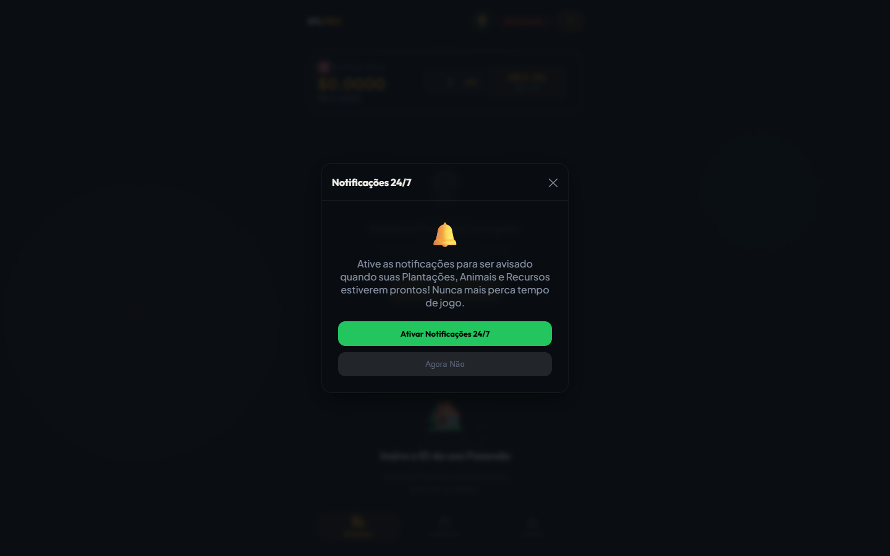

# SuperSFL (SFL Pro) 🌻

> Dashboard completo para gerenciar e monitorar seu progresso no jogo Web3 Sunflower Land.



## 🎮 Sobre o Projeto
O **SuperSFL (SFL Pro)** é uma ferramenta utilitária construída para jogadores de Sunflower Land. O dashboard permite:
- Acompanhar preços do mercado em tempo real.
- Visualizar e gerenciar a sua fazenda.
- Configurar alertas importantes.
- Acessar o mercado P2P.

## 🚀 Tecnologias Utilizadas
- HTML, CSS e JavaScript puros (Vanilla).
- PWA (Progressive Web App) configurado, pronto para ser instalado no celular (`manifest.json` e `sw.js`).
- Integração com Firebase/Supabase para funcionalidades em nuvem.

## 🛠️ Como rodar localmente
Este projeto é uma aplicação estática (frontend puro).
1. Clone o repositório:
   ```bash
   git clone https://github.com/markoswcs/SuperSFL.git
   ```
2. Abra o arquivo `index.html` em seu navegador ou use uma extensão como **Live Server** no VSCode para rodar e testar o PWA.

---
*Desenvolvido por markoswcs*
